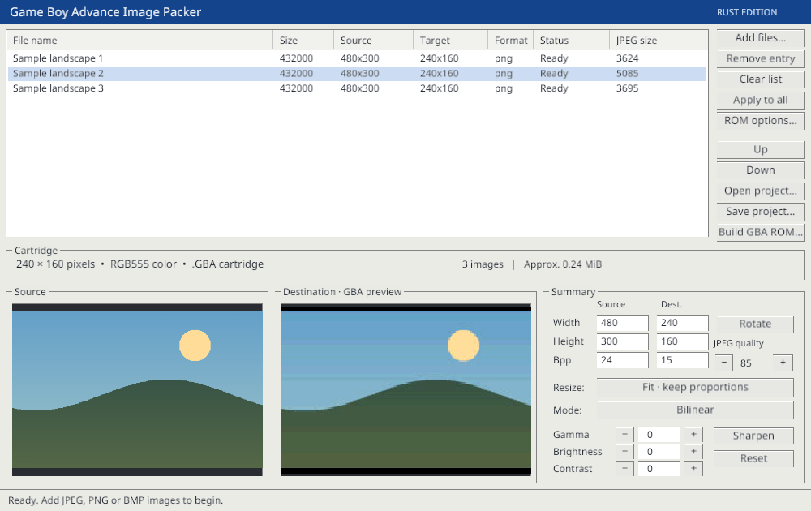
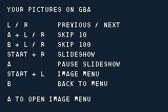
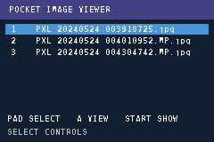
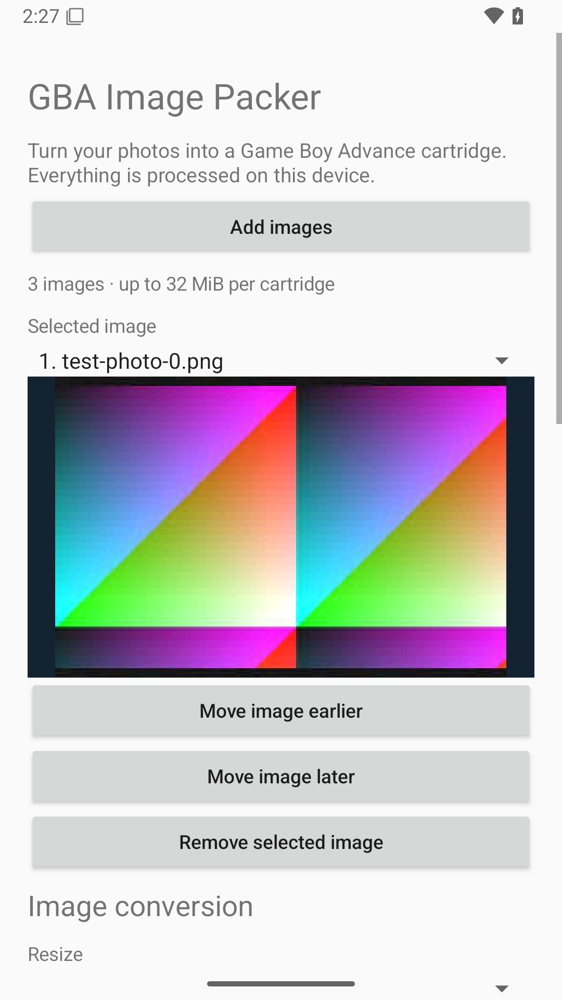

# GBA Image Packer

Create Game Boy Advance ROMs that display your pictures individually or as a slideshow. The desktop app accepts JPEG, PNG and BMP files, previews the GBA's 240 × 160 display, and builds a self-contained cartridge ROM for a flashcart or emulator.

Download a package for Linux x86_64, macOS Apple Silicon, Windows x86_64, or Android from [Releases](https://github.com/NewBarkTownKris/gba-image-packer/releases). Every package includes `example.gba`, a ready-to-play example album.

## Screenshots

**Linux desktop app** — image collection, conversion settings, and source/GBA previews.



**GBA ROM launch screens** — startup controls and the image-selection menu, captured in mGBA.

 

**Generated GBA ROM in mGBA** — the included `example.gba`, captured at the GBA's native 240 × 160 resolution.


**Android app** — image selection and conversion preview on Android 15.



## Setup and installation

The release packages are ready to run: you do not need Rust, Cargo, or a GBA compiler. Download the archive for your operating system from [Releases](https://github.com/NewBarkTownKris/gba-image-packer/releases), then follow the steps below. Every package includes a ready-to-play `example.gba` ROM.

### Windows

The Windows package supports **64-bit Windows 10 and Windows 11 on x86_64 PCs**. Windows 7, 8, 8.1 and 32-bit Windows are not supported by this build. Windows Server 2016 or later meets the Rust runtime's OS baseline, but server editions are not separately tested. These requirements follow the [Rust Windows MSVC target requirements](https://doc.rust-lang.org/stable/rustc/platform-support/windows-msvc.html).

1. Download the archive ending in `x86_64-pc-windows-msvc.zip`.
2. Right-click the ZIP in File Explorer and choose **Extract All**. Open the extracted folder.
3. Install Microsoft's [Visual C++ v14 Redistributable for x64](https://aka.ms/vc14/vc_redist.x64.exe) if it is not already installed. The application uses `VCRUNTIME140.dll`; see Microsoft's [supported redistributable downloads](https://learn.microsoft.com/en-us/cpp/windows/latest-supported-vc-redist).
4. Double-click `gba-image-packer.exe`.

Use your graphics hardware's Windows driver with OpenGL support. No separate file-dialog package is required on Windows.

### Windows XP (separate alpha)

An independent [native Windows XP edition](legacy-xp/README.md) targets **Windows XP SP3 32-bit**, an **SSE2-capable processor** (Pentium 4/Athlon 64 or newer), and a **1024 × 768** desktop. Download the package ending in `windows-xp-x86.zip`, extract it, and launch `gba-image-packer-xp.exe`. No Rust, .NET, OpenGL or modern Visual C++ runtime installation is required.

This alpha uses C++/Win32 and Windows' built-in GDI+ codecs. Its import audit, Wine XP-mode conversion checks and generated-ROM playback checks passed. Original Windows XP hardware or VM testing remains outstanding. See its instructions for the initial feature differences from the Rust edition.

### macOS (Apple Silicon)

The macOS package requires **macOS 11 Big Sur or later on an Apple Silicon Mac** (M-series processor). This download does not include an Intel Mac build.

1. Download the archive ending in `aarch64-apple-darwin.zip` and double-click it to extract it.
2. Drag `GBA Image Packer.app` to **Applications**, or keep it in the extracted folder.
3. Double-click the app to launch it.
4. The app is ad-hoc signed and is not notarized by Apple. If macOS blocks its first launch, open **System Settings → Privacy & Security → Open Anyway** after attempting to launch it, then confirm **Open**. On macOS 11–12, use **System Preferences → Security & Privacy → General → Open Anyway**. See [Apple's instructions for opening an app from an unidentified developer](https://support.apple.com/102445).

No Homebrew packages, Rust installation, or Xcode tools are needed to run the downloaded app.

### Android

The Android APK supports **Android 8.0 or later on ARM64 devices** and also includes x86_64 support for emulators. It does not support 32-bit ARM devices.

1. Download `gba-image-packer-1.0.0-android.apk` from Releases and open it. Allow your browser or file manager to install the app if Android asks.
2. Tap **Add images** to choose photos from Android's document picker.
3. Adjust conversion settings, arrange the album, then tap **Build and save GBA ROM** and choose where to save it.

All processing runs offline on the device. The app saves its editable album automatically and includes an option to export the example ROM. Imported copies are downsampled to at most 2048 pixels per side; source images are unchanged. See [Android instructions and source build setup](android/README.md) for details.

A separate [dual-screen Android edition](android/dual-screen/README.md) is available as an initial alpha for devices with an independently addressable second display, including setups like the AYN Thor. The second display shows the imported image and its converted GBA result side by side. Both Android editions have been tested on a physical AYN Thor running Android 13.

### Linux (x86_64)

Use a 64-bit x86_64 Linux desktop with an X11 session or XWayland, OpenGL support, and the libraries below. The release is built on Ubuntu 22.04; Ubuntu 22.04 or newer, Debian 12 or newer, and current Arch/Fedora installations are suitable starting points. Older distributions may need a local source build because of their system library versions.

Install the runtime dependencies for your distribution:

**Debian 13 / Ubuntu 24.04 and newer:**

```sh
sudo apt update
sudo apt install libx11-6 libxi6 libgl1 libasound2t64 zenity
```

**Debian 12 / Ubuntu 22.04:**

```sh
sudo apt update
sudo apt install libx11-6 libxi6 libgl1 libasound2 zenity
```

**Arch Linux:**

```sh
sudo pacman -Syu --needed libx11 libxi libglvnd mesa alsa-lib zenity
```

**Fedora:**

```sh
sudo dnf install libX11 libXi mesa-libGL alsa-lib zenity
```

Zenity provides the file dialogs; an existing KDialog installation can also be used. On a Wayland desktop, install XWayland if it is missing: `xwayland` on Debian/Ubuntu, `xorg-xwayland` on Arch, or `xorg-x11-server-Xwayland` on Fedora.

Download the archive ending in `x86_64-unknown-linux-gnu.tar.gz`, extract it, and launch the executable from the extracted folder:

```sh
tar -xzf gba-image-packer-1.0.0-x86_64-unknown-linux-gnu.tar.gz
cd gba-image-packer-1.0.0-x86_64-unknown-linux-gnu
./gba-image-packer
```

If your file manager did not preserve executable permissions, run `chmod +x gba-image-packer` first.

## Build an album

1. Click **Add files**, drag images onto the window, or pass file paths on the command line.
2. Select each image to adjust resize mode, resampling, JPEG quality, rotation, brightness, contrast, gamma and sharpening. **Apply to all** copies its settings to the collection.
3. Use **Up/Down** to order images. **Remove/Delete** removes the selected image; **Clear list** removes all images.
4. Open **ROM options** to set a cartridge title (up to 12 characters) and slideshow interval (1–60 seconds).
5. Click **Build GBA ROM** and copy the resulting `.GBA` file to a compatible flashcart.

**Fit** adds black borders while preserving proportions. **Fill** crops the center to fill the display. **Stretch** fills the display without preserving proportions. The destination preview includes JPEG compression and RGB555 color reduction.

**Save/Open project** preserves source paths, conversion settings, title and interval. Keep the source images available at those paths to reopen a project. Conversion leaves source files untouched.

## GBA controls

The viewer starts on the controls screen. Press **A** to open image selection.

| Action | Controls |
| --- | --- |
| Choose image in menu | D-pad, then A |
| Start slideshow in menu | Start |
| Previous / next image | L / R |
| Skip 10 images | Hold A + L / R |
| Skip 100 images | Hold B + L / R |
| Pseudo-random image | A + B |
| Start slideshow while viewing | Start + R |
| Pause / resume slideshow | A |
| Return to image selection | B, or Start + L |
| Show controls | Select |

Each image is stored as a 76,800-byte RGB555 frame plus its compressed JPEG. Albums must fit the 32 MiB cartridge limit. Timing follows the GBA frame clock at approximately 60 frames per interval second. The viewer displays images at screen size and does not support zoom or audio.

## Build from source

These developer tools are only needed when compiling the program yourself. Download the source archive from [Releases](https://github.com/NewBarkTownKris/gba-image-packer/releases) or clone this repository, and run build commands from the folder containing `Cargo.toml`.

Install the current stable Rust toolchain using [rustup](https://rustup.rs/), then install the platform-specific build tools below.

### Windows build tools

1. Install [Visual Studio Build Tools](https://visualstudio.microsoft.com/downloads/#build-tools-for-visual-studio) with the **Desktop development with C++** workload, including the MSVC x64/x86 tools and a Windows SDK.
2. Run the Windows rustup installer from [rustup.rs](https://rustup.rs/), choosing the default MSVC toolchain. Restart your terminal after installation.
3. In PowerShell, build and launch the application:

```powershell
cargo build --release --locked --target x86_64-pc-windows-msvc
.\target\x86_64-pc-windows-msvc\release\gba-image-packer.exe
```

The supported Windows versions are the same as for the downloaded Windows package above.

### macOS build tools

Install the Xcode command line tools, complete their installation dialog, and install stable Rust from [rustup.rs](https://rustup.rs/):

```sh
xcode-select --install
```

On an Apple Silicon Mac, build and launch with:

```sh
cargo build --release --locked --target aarch64-apple-darwin
./target/aarch64-apple-darwin/release/gba-image-packer
```

### Linux build tools

Install the runtime dependencies from the setup section, plus the compiler and development libraries for your distribution:

**Debian / Ubuntu:**

```sh
sudo apt install build-essential pkg-config libx11-dev libxi-dev libgl1-mesa-dev libasound2-dev
```

**Arch Linux:**

```sh
sudo pacman -Syu --needed base-devel pkgconf libx11 libxi libglvnd mesa alsa-lib
```

**Fedora:**

```sh
sudo dnf install gcc gcc-c++ make pkgconf-pkg-config libX11-devel libXi-devel mesa-libGL-devel alsa-lib-devel
```

Build and launch with:

```sh
cargo build --release --locked
./target/release/gba-image-packer
```

You can also pass images on the command line: `cargo run --release -- path/to/picture.jpg`.

The GBA firmware binary is embedded in the executable, as are the UI font and assets. Desktop builds need no GBA cross compiler. To rebuild the firmware after editing it, install GNU Arm Embedded tools and run `sh firmware/build.sh`.

The release workflow builds on all three native operating systems and packages the executable, documentation, dependency licenses and example ROM. To package a local build:

```sh
cargo fetch --locked
python3 scripts/package.py --target x86_64-unknown-linux-gnu --binary target/release/gba-image-packer
```

Development checks:

```sh
cargo fmt --check
cargo test --locked
mkdir -p target/verification
xvfb-run -a target/release/gba-image-packer --self-test target/verification/self-test.json --screenshot target/verification/app.png
cc firmware/test_rom.c -o target/verification/test-rom -lmgba
cd target/verification
./test-rom self-test.GBA
```

The emulator harness requires mGBA development headers and checks boot, pixel output, browsing, skip controls, slideshow and pause. Physical hardware and platform GUI validation should be reported separately from automated build checks.

## License

MIT. See [LICENSE](LICENSE) and [CREDITS.md](CREDITS.md). Font licenses are in `assets/`; release packages include dependency license texts in `licenses/`.
