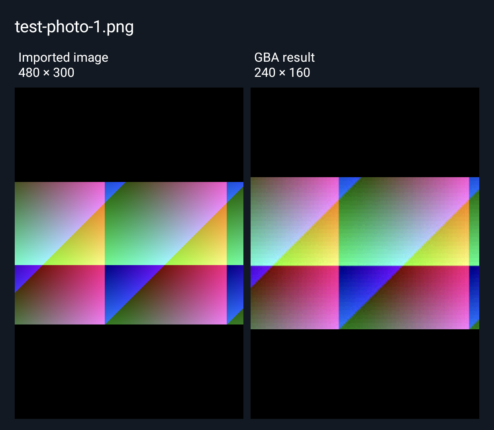

# GBA Image Packer Dual — Android preview edition

This separate Android app uses a second Android presentation display for a half-and-half comparison of the selected image and its converted GBA frame. It installs alongside the ordinary Android app, with its own editable album. It shares the existing Rust conversion engine and GBA firmware.

## Use

1. Install `gba-image-packer-dual-1.0.0-alpha1-android.apk` on an Android 8.0+ ARM64 device (x86_64 is also included).
2. Enable both screens in your device's display settings and launch **GBA Image Packer Dual** on the screen you want to use for editing.
3. Import images and select one. The other screen shows two equal-width panes: the imported image on the left and the 240 × 160 GBA result on the right. Both panes show the full image with its aspect ratio preserved; the GBA pane keeps sharp pixel boundaries.
4. Change conversion settings and tap **Apply settings and update preview**. The comparison updates to the selected image and the applied result.
5. Use **Choose preview display** to select an available presentation display, return to **Automatic**, or keep the comparison on **This screen only**.
6. Build and save ROMs using the ordinary Android workflow.

When a second display is active, the inline preview collapses to leave more room for editing controls. If the display disconnects or becomes unavailable, the comparison returns to the control screen. Automatic mode detects reconnection. The display is released when the app leaves the foreground.

Imports retain the standard app's 2048-pixel maximum dimension. The comparison decodes its source preview separately, limited to a 1024-pixel maximum dimension, and uses the actual converted RGB555 frame on the right. Selecting another image discards outdated source-preview work. This bounded preview does not change the imported image or exported ROM.

## Device support

The first build targets devices such as the AYN Thor through Android's standard [Presentation](https://developer.android.com/reference/android/app/Presentation) and [DisplayManager](https://developer.android.com/reference/android/hardware/display/DisplayManager) APIs. It also works with Android-compatible external presentation displays. It requires an independently addressable presentation display; a mirrored screen or a foldable reported as one display does not provide a separate preview surface.

Display IDs and resolutions are discovered at runtime. Android’s preferred presentation displays are considered first, followed by other public secondary displays exposed by dual-screen firmware. There are no fixed Thor display numbers, root requirements, vendor services or broad storage permissions. Android can refuse a presentation on a display currently used by the app's control task; the app keeps the inline comparison available when that happens.

This is an initial alpha. Automated verification uses Android 13 and Android 15 emulators and real virtual-display surfaces at 1240 × 1080 and 1080 × 1240. Both Android editions have also passed testing on a physical AYN Thor running Android 13: image import, conversion, ordering, ROM export and album restoration. The dual edition additionally passed checks of its actual second display, equal source/result panes, exact converted frame, selection changes, manual routing and inline fallback. The comparison recovered after sleeping and waking the Thor. Hardware-generated ROMs from both editions passed mGBA playback verification.

The Thor’s lower display during hardware testing, showing generated sample images:



## Build

Use the [Android SDK, NDK and Rust setup](../README.md#build-on-linux), then:

```sh
python3 android/build.py --dual-screen --test
```

Outputs are written to `dist/android-dual-screen/`. The public app package is `io.github.newbarktownkris.gbaimagepacker.dual`; the ordinary app uses `io.github.newbarktownkris.gbaimagepacker`. Their private albums are independent. Both editions use the local signing key described in the Android build instructions.

## Verify

The Android workflow installs both app editions on the same emulator. The dual-screen test also runs the regular image import, conversion, ROM export and album-restoration checks. It then creates a secondary display backed by an `ImageReader` and checks:

- Equal-width source and result panes, with distinct source and converted bitmaps.
- Exact agreement between the GBA result pane and the converted frame.
- Correct source selection after rapid selection changes.
- Automatic and manual routing, plus an inline-only mode.
- Presentation layout after resizing to portrait dimensions.
- Inline fallback after disconnect and automatic recovery after reconnect.

The workflow saves screenshots from the secondary surface, the control display and the inline fallback, and plays the generated ROM through mGBA. To run it on an Android 10+ emulator or test device after building:

```sh
adb install -r dist/android-dual-screen/gba-image-packer-dual-1.0.0-alpha1-android.apk
adb install -r dist/android-dual-screen/dual-screen-instrumentation.apk
adb shell am instrument -w io.github.newbarktownkris.gbaimagepacker.dual.test/io.github.newbarktownkris.gbaimagepacker.dualtest.DualSmokeInstrumentation
```

Use a fresh app installation for the instrumentation, which imports three generated photos into an empty album. The virtual-display tests exercise Android's presentation behavior rather than any particular manufacturer's firmware.

To test an actual secondary display instead of creating virtual test displays, add `-e physical true` to the instrumentation command. Both panels must be awake, and the test installation must have an empty album. The physical test imports generated images; do not run it against an album containing personal images.
